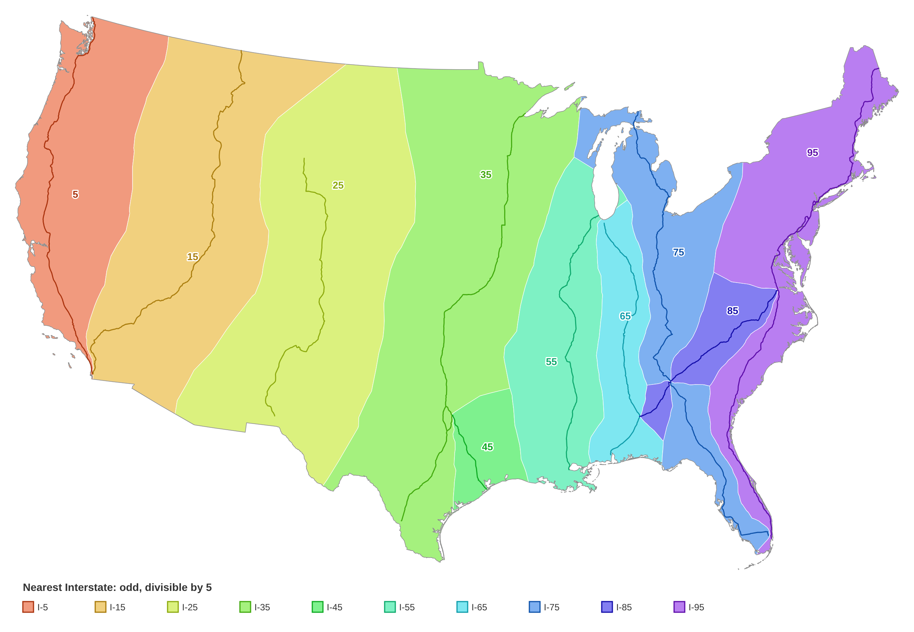
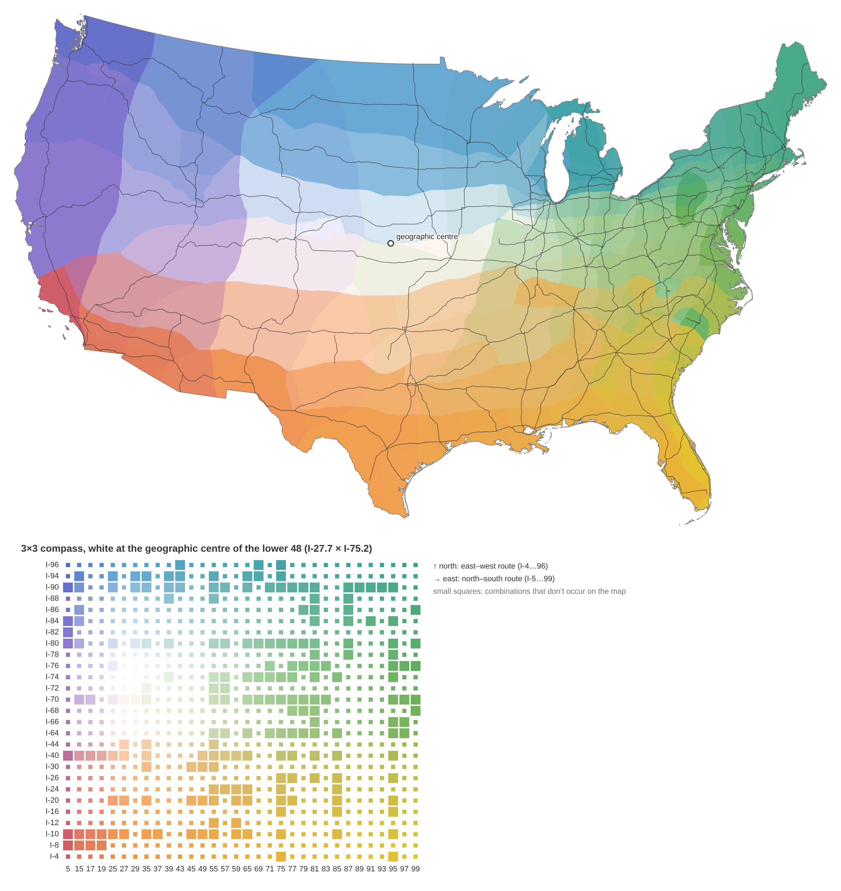

# voronoi-highways

Voronoi polygon experiments creating colorful maps of the USA based on distance to the nearest highway.

Every point in the lower 48 is assigned to its nearest highway from a chosen set: for example, the north–south Interstates numbered 5, 15, 25 … 95. The result is coloured by route number. Interstate numbers follow a grid: odd numbers run north–south and increase west to east, and even numbers run east–west and increase south to north. Overlaying a north–south map with an east–west map makes a **bivariate** map, where each place's colour comes from its pair of nearest routes.

| Nearest of I-5, 15, 25 … 95 | All odd × all even Interstates, compass palette |
|---|---|
|  |  |

## Setup

Python 3.11+.

```sh
python -m venv .venv
.venv/bin/pip install -r requirements.txt
.venv/bin/playwright install chromium   # for PNG previews; or set CHROME_PATH to an existing Chromium
```

Every SVG is also saved as a 2× PNG preview, rendered with headless Chromium through Playwright. If you can't download Playwright's browser, set `CHROME_PATH` to a Chromium or Chrome binary.

## Pipeline

Run the scripts from the repository root, in this order. All outputs go to `data/` and `output/`; both are git-ignored and rebuilt by these steps.

| Step | Command | Makes |
|---|---|---|
| 1. Get data | `python scripts/download_data.py` | Natural Earth 1:10m roads and states (lakes removed) in `data/raw/`, pinned to one commit and checked by SHA-256 |
| 2. Prepare | `python scripts/prepare.py` | `data/processed/`: the lower-48 outline, plus Interstates and US highways with a `routes` list per segment |
| 3. Highway map | `python scripts/render_svg.py` | `output/lower48_highways.svg` |
| 4. Nearest-route maps | `python scripts/voronoi.py [selection …]` | `output/voronoi_<selection>.svg` and regions in `data/processed/` |
| 5. Bivariate maps | `python scripts/bivariate.py [ns ew [scheme …]]` | `output/bivariate/<ns>__<ew>__<scheme>.svg` |
| 6. Palette page | `python scripts/export_web.py --check` then `python scripts/check_web.py` | `output/web/interstate_palettes.html`, an interactive palette explorer |

Step 5 needs both of its selections from step 4. The defaults are `x5_odd x10`; the all-Interstates pair is `odd even`.

### Selections (`scripts/selection.py`)

| Name | Routes |
|---|---|
| `x5_odd` | Interstates under 100 that are odd and divisible by 5 (I-5 … I-95) |
| `odd` | all odd Interstates under 100 (north–south) |
| `x10` | Interstates divisible by 10 (I-10 … I-90) |
| `even` | all even Interstates under 100 (east–west) |
| `us_odd` | odd US highways up to US 101 |
| `us_even` | even US highways under 100 |

Interstates and US highways are never mixed. Colours come from a lookup of each route number on a fixed 0–100 scale, not from its rank in the list. That keeps colours consistent between selections whose numbers are spaced unevenly.

### How the nearest-route regions are built

1. Each selected route is split into points every 1 km, and each point is tagged with its route number. Where routes share pavement, or points coincide at junctions, the lowest number wins.
2. Voronoi cells are built around those points in Conus Albers (EPSG:5070).
3. The cells are dissolved by route number and clipped to the lower-48 outline.

For bivariate maps, the north–south and east–west region layers are intersected. Each piece then carries both numbers, and a colour function turns the pair into a colour. Colour schemes live in `SCHEMES` in `scripts/bivariate.py`. Most are grids of control colours (2×2 up to 5×5) blended in OKLab, and a grid's middle can be moved, for example to the geographic centre of the lower 48.

### Palette page

`export_web.py` exports the bivariate cells, routes and every scheme in `SCHEMES` as JSON. It inlines them into `web/palette_template.html` to make a single self-contained page. On the page you can:

- pick, edit and save palettes;
- fade automatically through all of them, or blend any two by hand;
- view the major-route and all-Interstate maps on their own or side by side.

"Copy for bivariate.py" turns a palette made on the page into a `SCHEMES` entry. `check_web.py` confirms that the page's JavaScript colours match the Python ones to within 1/255.

### Easter egg: the Interstate Electoral College

On the palette page, type `538`, click the shield in the header, or open the page with `#538` at the end of its URL to treat the 54 zones of the major-routes map as states and replay the 2024 presidential election. `python scripts/electoral.py` makes the numbers behind it:

- **Population:** Census 2020 block-group centres of population, each counted in the zone it falls in.
- **Votes:** 2024 county results ([tonmcg/US_County_Level_Election_Results_08-24](https://github.com/tonmcg/US_County_Level_Election_Results_08-24)), shared out within each county by block-group population. Connecticut (planning regions) and DC (wards) are shared out state-wide.
- **Names:** each zone is named after its largest city, the Natural Earth populated place with the biggest `POP_MAX` inside it (or the nearest one, for two tiny zones with none). The map marks each city with a dot and its name.
- **Electoral votes:** 2 per zone plus 430 House seats by Huntington–Hill (at least 1 each), for 538 in all. Winner takes all.

It reads the committed polygons in `results/` and writes `results/electoral_x5_odd__x10.csv`. `export_web.py` picks that CSV up if it exists. The result is R 315 – D 223, against the real 312–226.

`results/` holds committed copies of `voronoi_x5_odd`, `voronoi_x10` and `bivariate_x5_odd__x10` (steps 4–5), so the zones can be used without rerunning the pipeline. After a rebuild, refresh them with `cp data/processed/{voronoi_x5_odd,voronoi_x10,bivariate_x5_odd__x10}.geojson results/`.

## Natural Earth data fixes

Natural Earth stores one route number per road segment, and some segments are mislabelled. `prepare.py` works around this as follows:

- **Shared stretches:** routes that share pavement (I-55/I-70 through St. Louis, I-20/I-59 between Birmingham and Meridian, and so on) are reconstructed by finding paths through the network between a route's loose ends. Short gaps are closed with marked connector lines.
- **Known mislabels:** these are fixed from a table (`FIXES`), and state routes tagged as US highways are reclassified.

The problems found are written up, with annotated figures, in [docs/natural-earth-issues/ISSUES.md](docs/natural-earth-issues/ISSUES.md). `python scripts/ne_issue_figures.py` regenerates the figures from the raw data.

## Layout

```
scripts/      pipeline (see above); routes.py = route reconstruction, svgmap.py = SVG/PNG writer,
              colorspace.py = OKLab helpers
web/          palette page template
results/      committed zone polygons for the fives map, and the Electoral College CSV
docs/         Natural Earth issue write-up and figures
data/, output/  generated, git-ignored
```

Data: [Natural Earth](https://www.naturalearthdata.com/), public domain. Easter egg: Natural Earth populated places; US Census Bureau 2020 centres of population; 2024 county results compiled by tonmcg.
