# Natural Earth `ne_10m_roads` – US Interstate problems

Found while building Interstate-number maps of the lower 48 from
`ne_10m_roads` **v5.2.0-pre** (GeoJSON from `nvkelso/natural-earth-vector@master`, Oct 2026).
Each issue lists how to find the feature: `name`, `uident`, and its endpoints (lat, lon).
Figures: magenta = problem feature, blue = related correctly-labelled routes,
orange dashed = where a missing road should be, gray = other Interstates (gray text = `name` field), tan = US highways, light gray = state routes.

Could be filed as one issue with a checklist, or one issue per item.

---

## 1. I-84 labelled `name="5"` east of Portland, OR
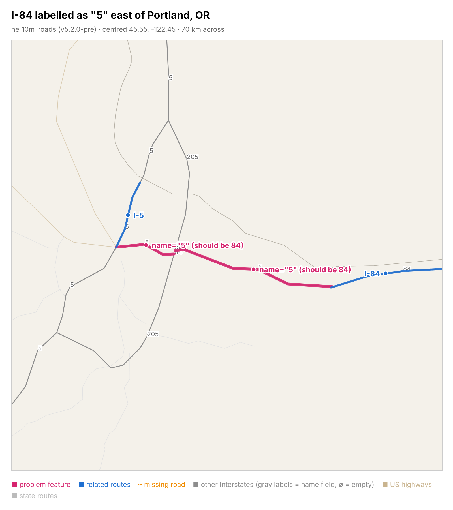

Two `level=Interstate` segments east of Portland have `name="5"`; they are I-84 (Banfield Fwy / Columbia River Gorge).

| uident | endpoints | is | should be |
|---|---|---|---|
| 20905 | (45.517, -122.677) → (45.531, -122.557) | `5` | `84` |
| 23805 | (45.548, -122.222) → (45.536, -122.557) | `5` | `84` |

## 2. I-90 (Mercer Island floating bridge) labelled `name="5"`, Seattle, WA
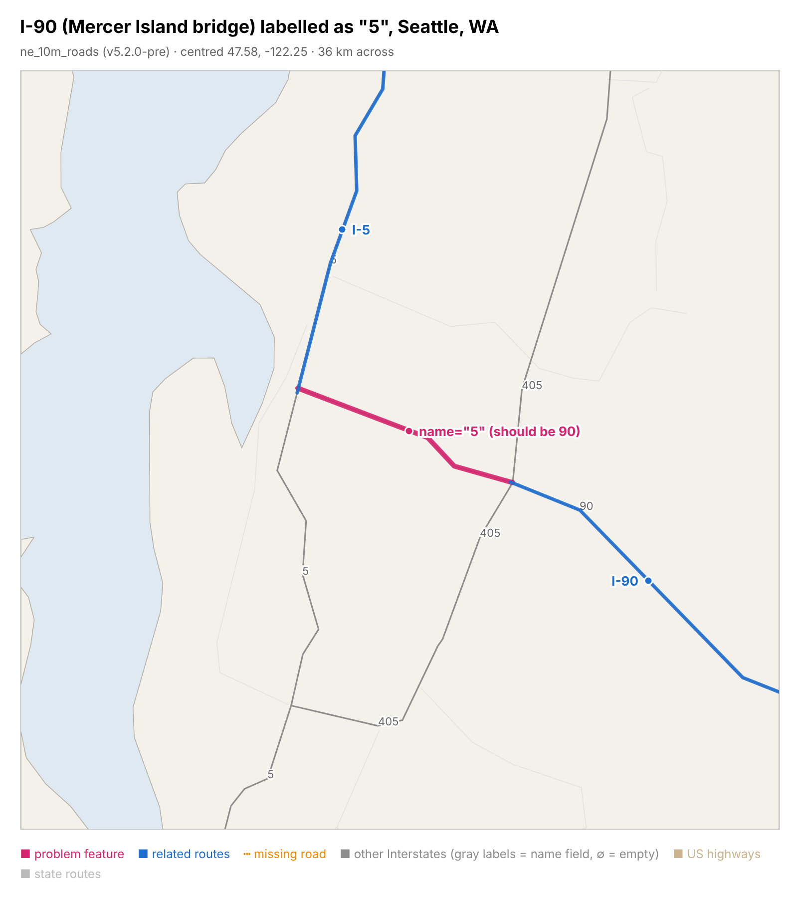

| uident | endpoints | is | should be |
|---|---|---|---|
| 0 | (47.580, -122.176) → (47.594, -122.322) | `5` | `90` |

## 3. I-94 and I-57 labelled `name="55"`, Chicago, IL
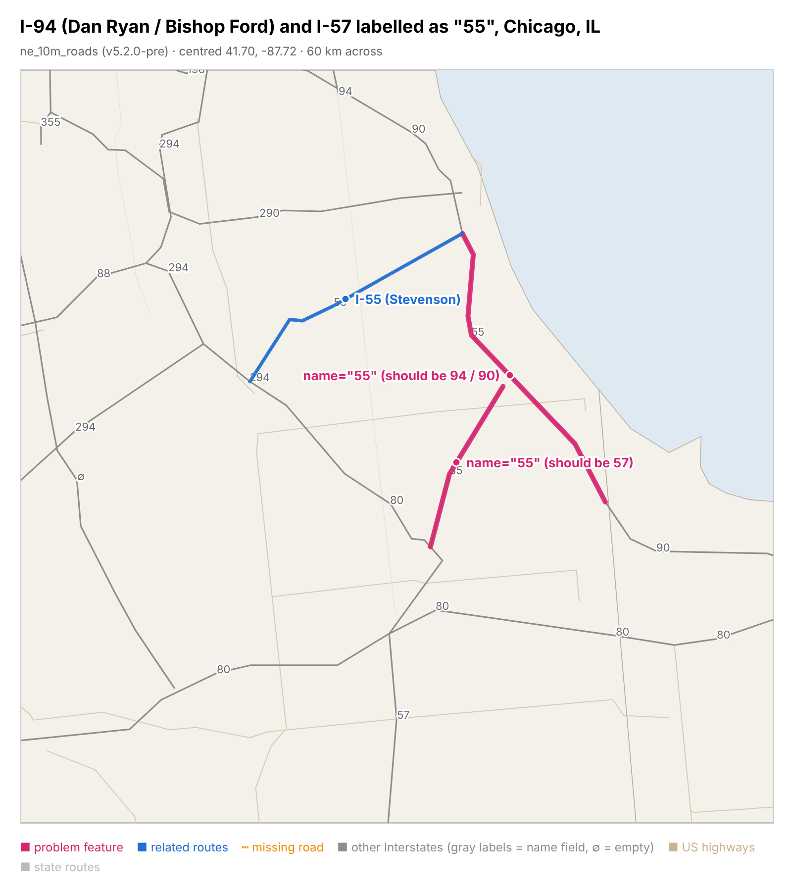

I-55 (Stevenson Expwy) is correct; two other South Side expressways also carry `name="55"`.

| uident | endpoints | is | should be |
|---|---|---|---|
| 90305 | (41.847, -87.639) → (41.647, -87.524) | `55` | `94` (Dan Ryan is I-90/94; Bishop Ford is I-94) |
| 0 | (41.627, -87.696) → (41.736, -87.613) | `55` | `57` |

## 4. I-55 missing between I-294 and I-80, SW Chicago suburbs, IL
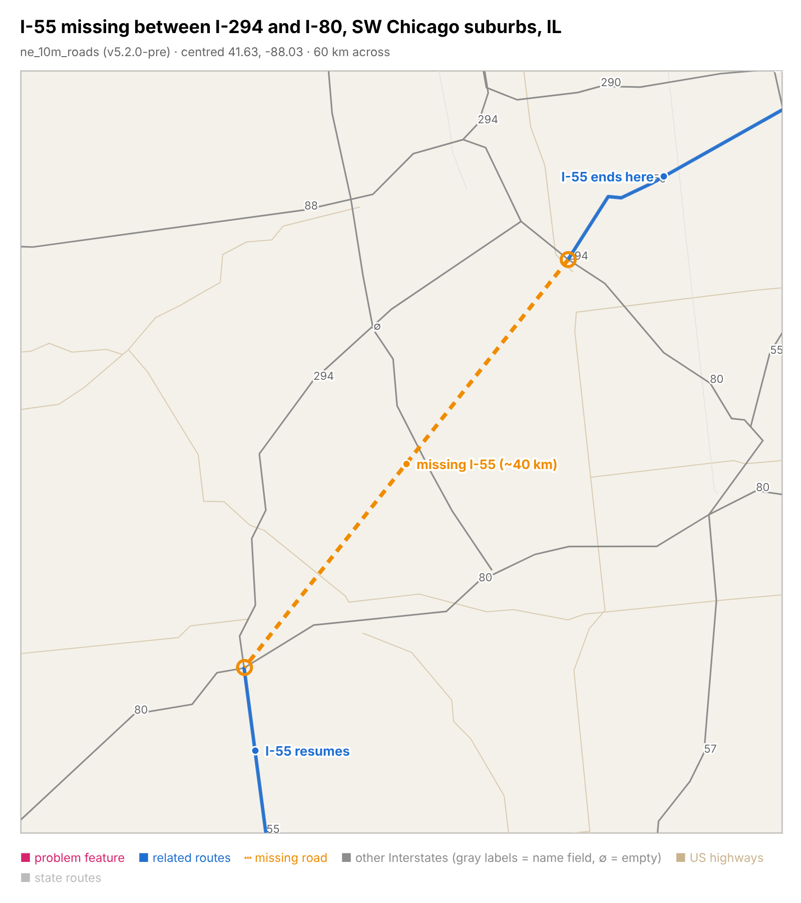

I-55 stops at the I-294 interchange (41.755, -87.856) and resumes at the I-80 interchange (41.488, -88.196).
The ~40 km between (through Bolingbrook / Joliet) is missing.

## 5. I-20 labelled `name="85"`, and I-85 missing south of downtown Atlanta, GA
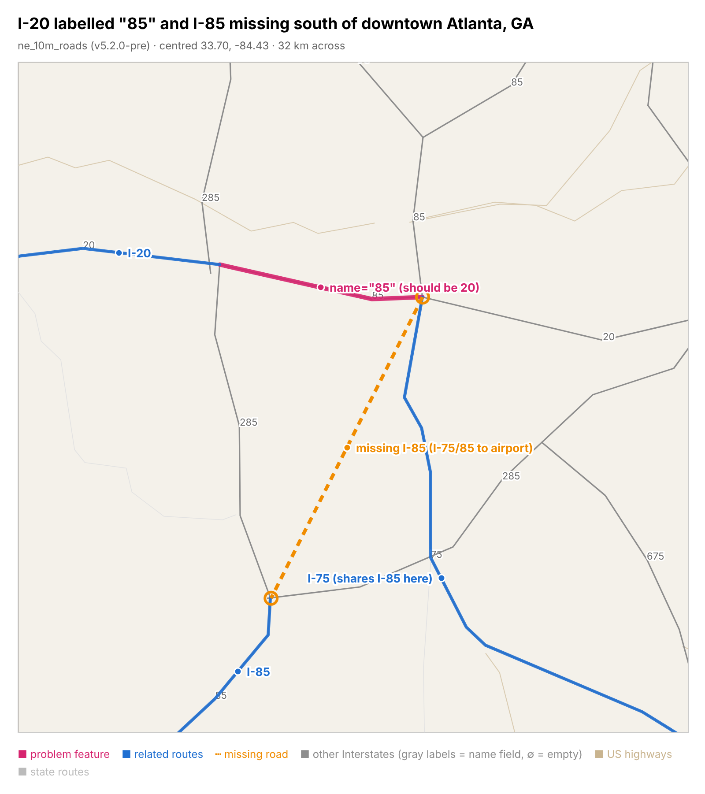

- uident 179505, (33.763, -84.491) → (33.739, -84.388), `name="85"`: this is I-20 west of downtown; should be `20`.
- I-85 between downtown (where I-75 comes in, 33.739, -84.388) and the airport / I-285 (33.619, -84.485) is missing, so I-85 is broken in two.

## 6. Kansas Turnpike (I-35) labelled `name="235"`, Wichita, KS
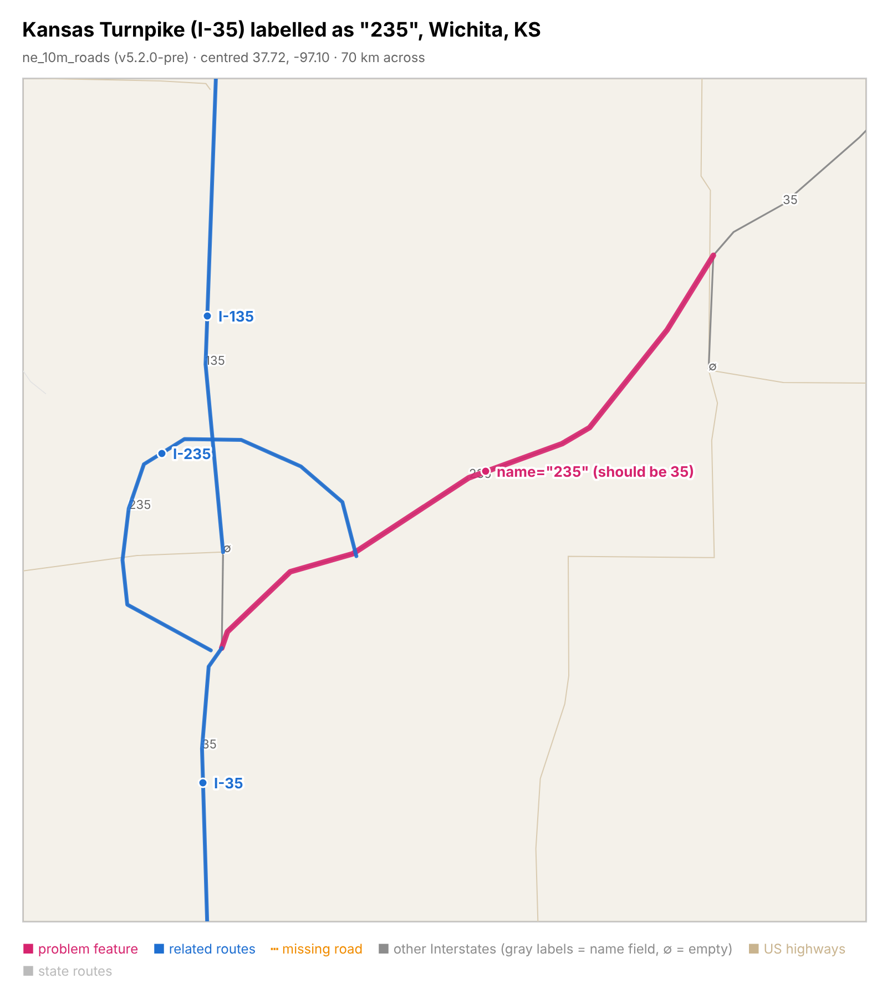

| uident | endpoints | is | should be |
|---|---|---|---|
| 146405 | (37.608, -97.310) → (37.903, -96.846) | `235` | `35` |

The real I-235 (west-side loop) is a separate feature. Also related: uident 146505, (37.679, -97.310) → (37.608, -97.310) has an empty `level` and `name`.

## 7. I-44 through Tulsa, OK labelled `name="75"` and `name="244"`
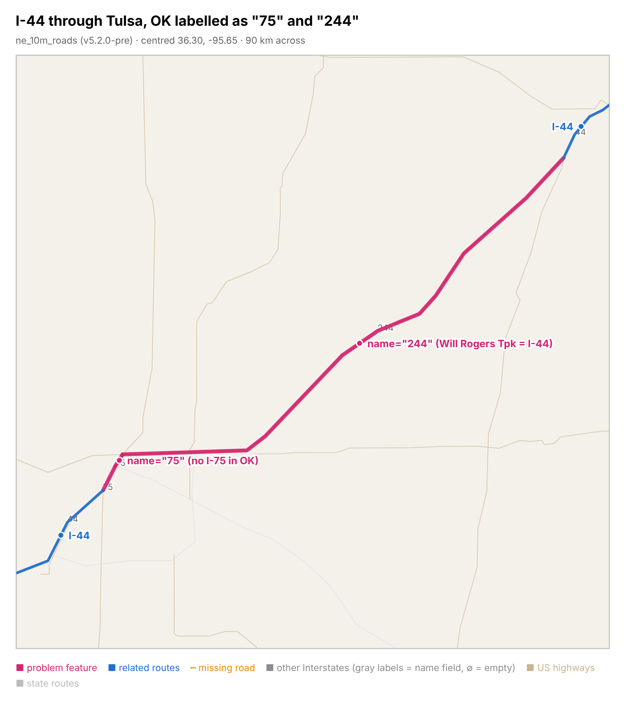

The chain of Interstate features from the Turner Turnpike to Missouri is `44 → 75 → 75 → 244 → 44`. There is no I-75 in Oklahoma,
and the 80 km "244" segment is the Will Rogers Turnpike (I-44).

| uident | endpoints | is | should be |
|---|---|---|---|
| 164405 | (36.113, -96.008) → (36.146, -95.987) | `75` | `44` (or `244` if this is meant to be the downtown loop) |
| 163905 | (36.146, -95.987) → (36.162, -95.975) | `75` | `44` / `244` |
| 163705 | (36.162, -95.975) → (36.561, -95.219) | `244` | `44` |

## 8. I-65 doesn't connect north of downtown Nashville, TN
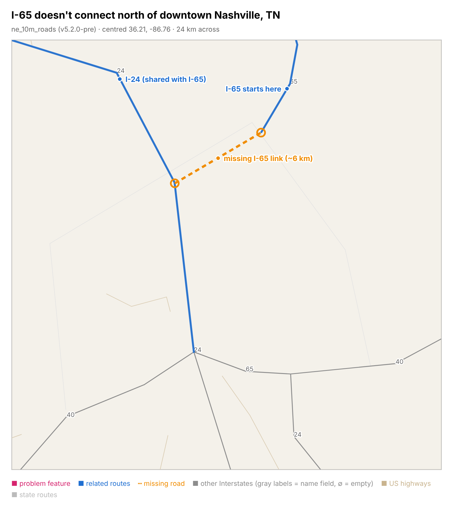

I-65 north (uident 154205) starts at (36.269, -86.731), about 6 km from the I-24 line (I-24/65 shared section), and doesn't
connect to it. Either the missing link or an undershoot.

## 9. I-71/I-75 segment with empty `name`, Cincinnati, OH / KY
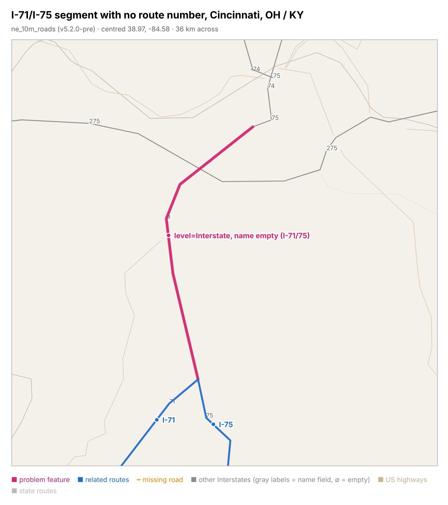

uident 120005, (39.062, -84.537) → (38.878, -84.621), `level=Interstate`, `name` empty. This is the I-71/I-75 shared section
through Covington (should be `name=75`, `namealt=71`).

## 10. I-40/I-85 link with empty `level` and `name`, Greensboro, NC
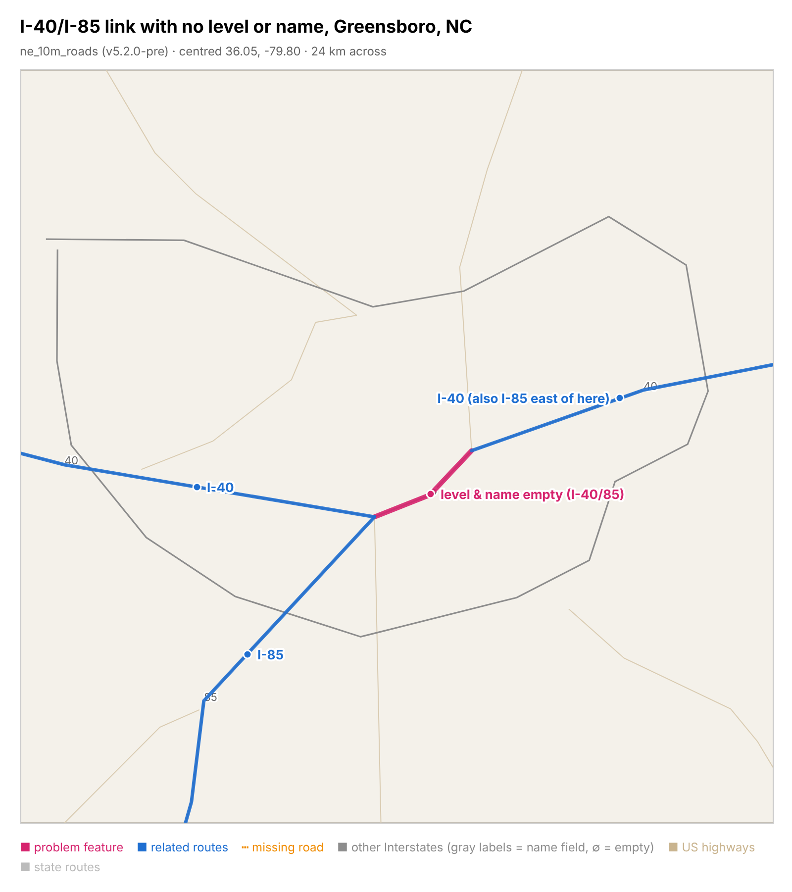

uident 141905, (36.045, -79.774) → (36.031, -79.812): no `level`, no `name`. It's the link where I-85 joins I-40 (I-40/85 shared).

## 11. I-80 labelled `name="70"` near York, NE
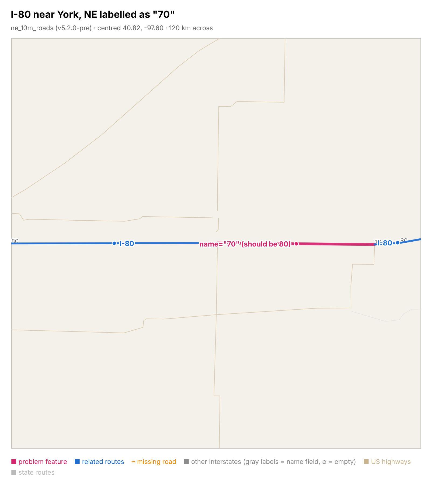

| uident | endpoints | is | should be |
|---|---|---|---|
| 110805 | (40.821, -97.595) → (40.823, -97.044) | `70` | `80` |

## 12. I-40 labelled `name="44"` at Fort Smith, AR
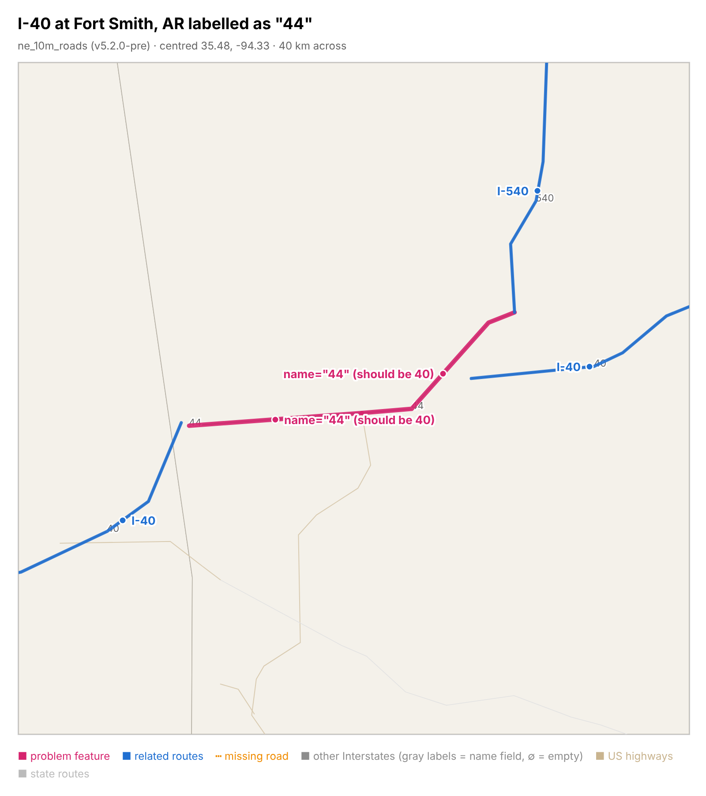

There is no I-44 in Arkansas; these two segments link the Oklahoma and Arkansas parts of I-40.

| uident | endpoints | is | should be |
|---|---|---|---|
| 170605 | (35.472, -94.325) → (35.467, -94.440) | `44` | `40` |
| 170405 | (35.472, -94.325) → (35.524, -94.222) | `44` | `40` |

## 13. US 2/97 shared section has `namealt="95"`, Wenatchee, WA
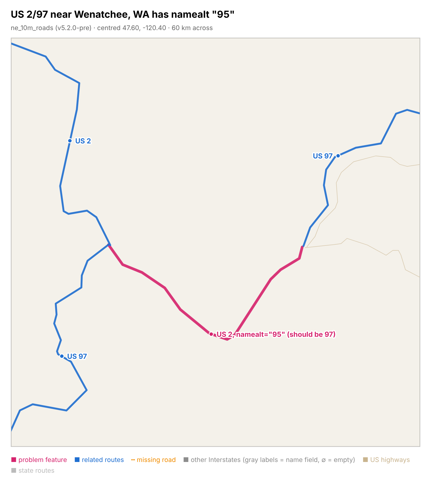

| uident | endpoints | is | should be |
|---|---|---|---|
| 11405 | (47.561, -120.600) → (47.623, -120.235) | `name=2`, `namealt=95` | `namealt=97` |

## 14. State routes classed as US highways (`level=Federal`)
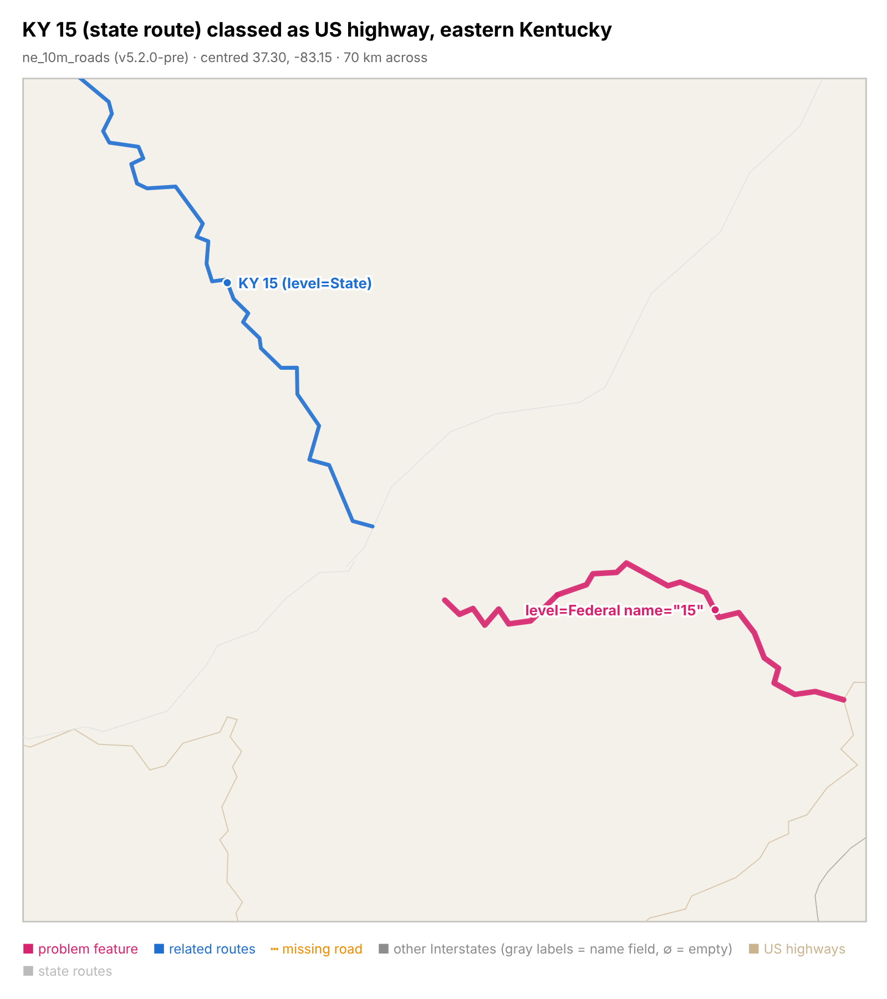

These `level=Federal` segments carry numbers of US routes that don't run there (or don't exist). In most cases neighbouring
segments of the same road are already `level=State`. Should be `level=State`.

| uident | where | name | actually |
|---|---|---|---|
| 14096, 14097 | eastern KY, (37.219, -83.056) | `15` | KY 15 (US 15 doesn't enter Kentucky) |
| 31188 | McMinnville–Sparta, TN, (35.696, -85.809) → (35.936, -85.484) | `1` | TN SR 1 (US 1 doesn't enter Tennessee) |
| 31223 | southern TN, (35.072, -86.271) → (35.299, -85.903) | `50` | TN SR 50 |
| 22903 | northern MS, (34.212, -90.530) → (34.310, -89.919) | `6` | MS 6 |
| 36081 | Oklahoma panhandle, (36.678, -101.474) → (36.617, -100.523) | `3` | OK SH 3 |
| 233605 | north of Laredo, TX, (27.531, -99.479) → (27.760, -99.439) | `85` | not US 85 (no US 85 in Texas) |
| 38027 | PA/NJ near Trenton, (40.38, -74.96) | `32` | PA 32 (no US 32 exists) |
| 38272, 38273 | western PA, (40.87, -79.87) | `38` | PA 38 (no US 38 exists) |
| 38066 | western PA, (40.30, -79.54) | `66` | PA 66 (US 66 was never in PA) |

Similar 3-digit cases exist too, e.g. `104` near Norfolk, VA (US 104 is in New York) and `100`, `110` (no such US routes).

---

## Also worth mentioning (general, no figure)

- **Shared sections carry one number.** Where two Interstates share pavement only one is in `name`;
  `namealt` is set on only 13 US Interstate features. Examples: I-55/I-70 (St. Louis), I-75/I-40 (Knoxville),
  I-40/I-85 (Greensboro–Hillsborough), I-71/I-75 (N. Kentucky), I-35/I-70 (Kansas City), I-24/I-65 (Nashville).
  So following a route by number gives false gaps. A multi-value route field (or consistent `namealt`) would fix it.
- **Other Interstate features with empty `name`:** uident 0 beltway (45.081, -93.436) → (45.036, -93.071) in the Twin Cities;
  uident 0 beltway loop at Greensboro (36.122, -79.908); uident 0 (41.542, -87.954) → (41.943, -88.069) in Chicago's western suburbs
  (looks like I-355, also no `level`).
- **`uident` = 0** on many features, so it can't be used as a stable ID when reporting problems.
